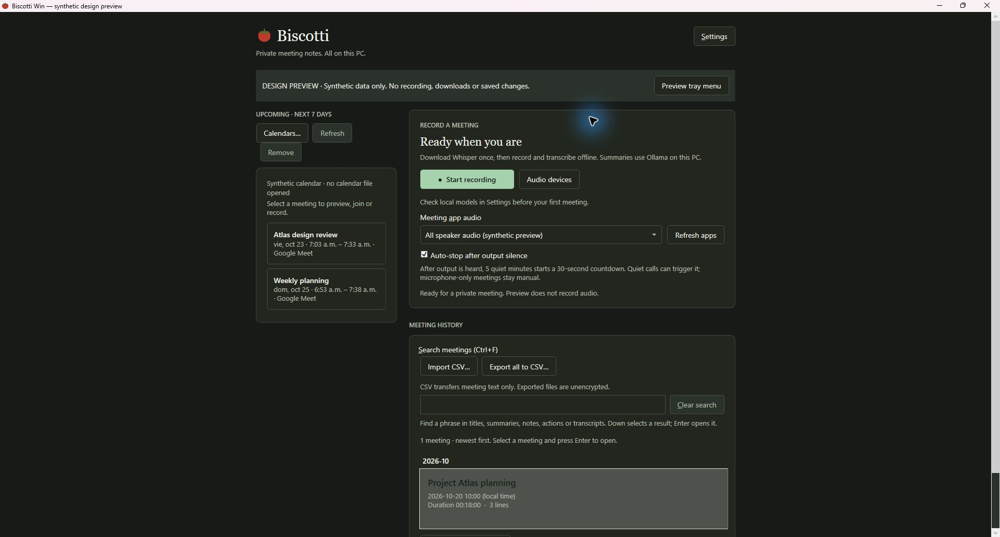
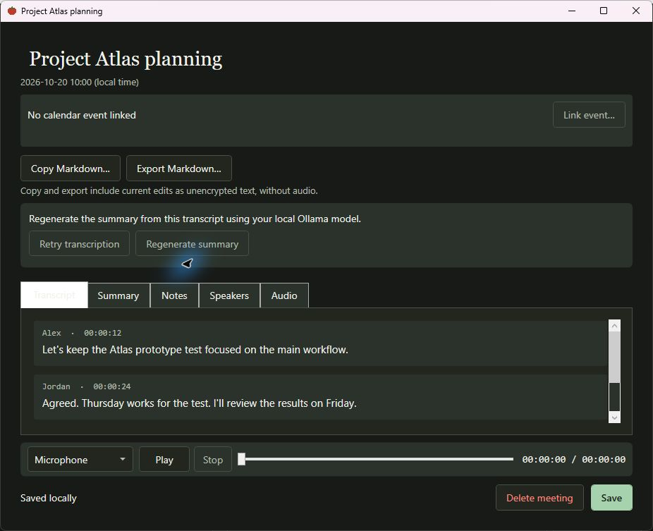
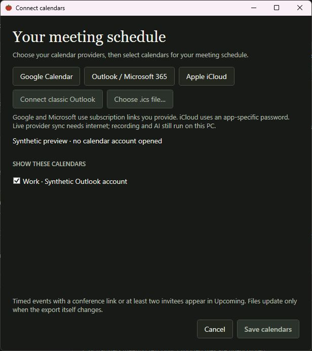

# Biscotti Win

Free, private meeting transcription and review for Windows. Biscotti captures your microphone and meeting audio, transcribes speech on your PC, and can create a summary with a local language model.

**Your meetings stay on your PC.** No account is required, no bot joins the call, and meeting audio, transcripts, summaries, and models are not uploaded. Network access is used for app/model/runtime downloads and, if you connect a provider, to fetch your calendar schedule. Recording and AI processing stay on this PC.

[Get started](#get-started) · [Download from Releases](https://github.com/d1dac0/biscotti-win/releases/latest) · [Windows installation](docs/windows-release.md) · [Calendar setup](docs/calendar-setup.md) · [Local MCP setup](docs/mcp-server.md)



*The current Windows app, shown with synthetic demonstration meetings. Screenshots contain no real meeting or calendar data.*

## What Biscotti can do

- **Record two audio tracks.** Capture your microphone and speaker audio separately. On supported Windows versions, choose a running app to capture; otherwise Biscotti can use device loopback after you confirm that it may include audio from every app. Choose your microphone and output device in Audio devices. In-person conversations can be recorded with the microphone alone.
- **Transcribe as you meet.** Whisper runs locally and shows an incremental transcript while recording, then processes the saved audio. Choose Whisper Large v3 Turbo (default, about 1.6 GB) or Small (about 466 MB). CPU transcription works without an NVIDIA GPU; compatible NVIDIA GPUs can use an optional CUDA runtime.
- **Create optional local summaries.** If Ollama is installed on this PC and has a local model available, Biscotti can generate a meeting title, summary, and action items. Choose a local model and summary preferences in Settings. Without Ollama or a model, recording and transcription still work.
- **Review and manage meetings.** Search titles, transcripts, summaries, notes and action items. Read speaker-labeled transcripts, correct labels, and retry or recover interrupted processing. A persistent audio player stays available across review tabs: choose microphone or speaker audio, scrub, or follow a timestamp to listen from that moment. Speaker labels are best effort; overlapping speech may not be separated.
- **Take notes and control recording.** Write Markdown notes and follow timestamp links back to the conversation. Use the tray menu or configurable global shortcut to start and stop. Optional silence-based auto-stop gives you a 30-second countdown and a Keep recording action before stopping; microphone-only meetings stay manual.
- **Use Windows appearance and audio support.** Biscotti follows Windows light or dark app mode and respects high contrast. Supported microphones can use Windows echo control with the selected output as a reference; when unavailable, recording continues with an explicit status rather than guaranteed echo cancellation. If a saved microphone disappears, Biscotti can restore the Windows default input.
- **Connect calendars (optional).** Add Google Calendar or Outlook / Microsoft 365 subscription links, Apple iCloud with an app-specific password, classic Outlook, or local `.ics` files. Preview the next seven days of meetings, join or record from an event, and link/change/remove event context in a recording. Saved access is protected with Windows DPAPI. See the [calendar setup guide](docs/calendar-setup.md).
- **Connect a local MCP client (optional).** The read-only Biscotti MCP server lets compatible clients search saved meetings and read meeting details or transcript pages. It does not record audio or call remote services. See the [MCP setup guide](docs/mcp-server.md).
- **Import and export meeting text.** Use CSV for meeting collections and Markdown for an individual meeting. Exports and clipboard copies are plain text and do not include audio; Biscotti asks before creating an export.

## A look inside

### Review the conversation

Speaker names and timestamps make the transcript easier to scan. The audio controls stay below the tabs while you review transcripts, summaries, notes or speakers.



### Bring your schedule

Connect Google Calendar, Outlook / Microsoft 365, Apple iCloud, classic Outlook or a local calendar file. Choose which calendars appear, then preview, join or record upcoming meetings from the home screen. Provider setup and refresh behavior are explained in the [calendar guide](docs/calendar-setup.md).



*These are actual app captures in dark mode using the built-in design preview. Playback is shown without recorded audio; disabled actions reflect preview mode. See [screenshot provenance and reproduction](docs/screenshots/README.md).*

## Requirements

### To run a release

- Windows 10 or 11, 64-bit.
- A microphone to record your voice. For calls, use a Windows audio output device for speaker audio.
- Free disk space for the Whisper model you choose: about 1.6 GB for Large v3 Turbo or 466 MB for Small, plus room for meeting recordings. Biscotti checks available space before downloading.
- Internet access for the initial app/model downloads. After downloads finish, recording, transcription, review, and Ollama summaries run locally.

The [Windows release guide](docs/windows-release.md) explains installation, updates, and uninstalling. The self-contained release includes the .NET and Windows app runtimes; you do not need to install them separately.

### Optional components

- **Summaries:** Install [Ollama](https://ollama.com) and download a model, for example `ollama pull gemma3:4b`. Ollama and the selected model must be available locally. Their disk and hardware needs depend on the model.
- **Faster transcription:** A compatible NVIDIA GPU and driver are required for the optional CUDA tier. If you opt in, Biscotti downloads about 330 MB of runtime files once. CPU transcription remains available without it.
- **Speaker grouping:** The first processed meeting downloads a 26.5 MB English speaker model. Grouping is approximate and does not separate overlapping speech. Cross-meeting voice memory is off until you opt in and save a voice.
- **Build from source:** .NET 10 SDK on Windows x64. Run `dotnet build -c Release BiscottiWin.slnx` from the repository root.

## Get started

1. Install Biscotti: download the signed ZIP from [Releases](https://github.com/d1dac0/biscotti-win/releases/latest) and follow the [Windows release guide](docs/windows-release.md), then launch `Biscotti.Win.exe`.
2. Download a Whisper model in the app. Large v3 Turbo is selected by default; choose Small in Settings if you prefer the smaller download.
3. To enable summaries, install Ollama, run `ollama pull gemma3:4b`, then choose an installed local model in Biscotti Settings.
4. Select your audio devices, optionally select the meeting app and connect calendars, then start recording.

## Privacy and where data is stored

Biscotti stores app data under `%LOCALAPPDATA%\BiscottiWin`:

- `Meetings\<guid>\meeting.json` and `meeting.md` contain meeting text and are protected with Windows DPAPI for your Windows user.
- `Meetings\<guid>\mic.wav` and `sys.wav` contain authenticated encrypted audio; their keys are protected with DPAPI.
- `Calendar\connections.dpapi` contains encrypted provider links and app-specific credentials, when configured.
- `Models\` contains downloaded Whisper and speaker models. Optional GPU runtime files are stored under `runtimes\`.

Protected meeting files are tied to the Windows profile that created them. DPAPI CurrentUser protects data at rest from other Windows users; it does not protect it from software already running as your account. When you export or copy meeting text, the destination is unencrypted, so choose a location with the privacy you need. See the [meeting data protection decision](docs/specs/dpapi-meeting-data-at-rest.md).

## Build and run from source

```powershell
dotnet build -c Release BiscottiWin.slnx
dotnet run --project Biscotti.Win
```

## Project status

The features above describe the current Windows app. Follow [open issues](https://github.com/d1dac0/biscotti-win/issues) for work in progress and planned improvements.
